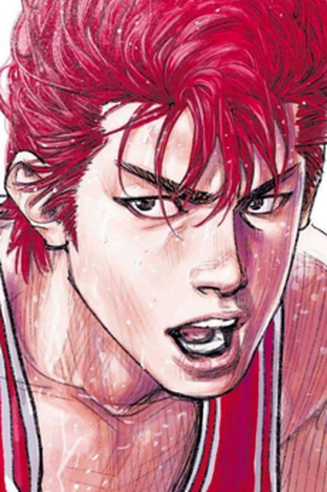
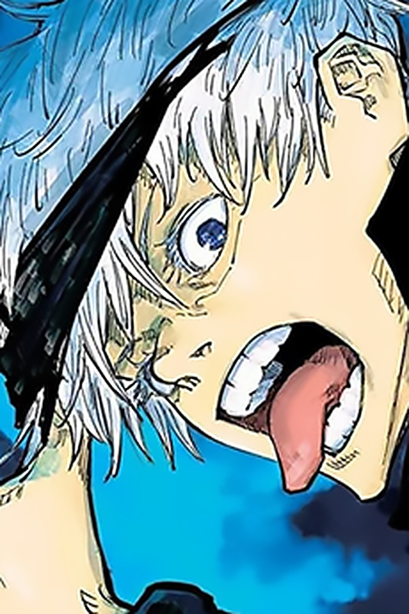

<p align="center">
  
</p>

<p align="center">
  <video src="https://raw.githubusercontent.com/bayshier/anime-character-museum/master/docs/media/demo.webm" controls muted playsinline preload="metadata" width="100%"></video>
  <sub><i>25 秒逛馆演示：搜索 → 档案弹窗 → 主题曲自动播放 → 全息闪卡 → 下载收藏（若播放器未显示，<a href="docs/media/demo.webm">点此观看</a>）</i></sub>
</p>

<h1 align="center">经典动漫人物博物馆</h1>

<p align="center">
  <b>ANIME CHARACTER MUSEUM · SINCE 1980</b><br>
  一座免费开放的线上展馆：1980 年至今照亮荧屏的 <b>214 位经典人物</b>、<b>112 部作品</b>、<b>五座年代展厅</b>。<br>
  每件展品都有中文展签、观察引导、讲解词、名台词、主题曲与可下载收藏的<b>全息闪卡</b>。
</p>

<p align="center">
  <a href="https://bayshier.github.io/anime-character-museum/"><b>🏛️ 进入线上展馆</b></a> ·
  <a href="#-五座年代展厅">五座展厅</a> ·
  <a href="#-功能亮点">功能亮点</a> ·
  <a href="#-全息闪卡">全息闪卡</a> ·
  <a href="#-技术实现">技术实现</a> ·
  <a href="NOTICE.md">权利声明</a>
</p>

<p align="center">
  <i>免费参观 · 无需账号 · 无广告 · 无统计脚本</i>
</p>

## 🏛️ 五座年代展厅

| 展厅 | 展品 | 收录作品一览 |
|---|---|---|
| 📺 [80年代馆](https://bayshier.github.io/anime-character-museum/) | **72 件** | 哆啦A梦、机动战士高达、铁臂阿童木、阿拉蕾、福星小子、足球小将、北斗神拳、龙珠、圣斗士星矢、城市猎人、乱马½、龙珠Z、超时空要塞、棒球英豪、鲁邦三世、阿基拉、风之谷、天空之城、龙猫、花仙子、聪明的一休、尼尔斯骑鹅旅行记、橙路、魔神坛斗士、机动警察、魔神英雄传、宇宙海盗哈洛克船长、奇天烈大百科、装甲骑兵、森林大帝、凡尔赛玫瑰、银河铁道999、猫眼三姐妹、相聚一刻、天空战记、筋肉人 |
| 💿 [90年代馆](https://bayshier.github.io/anime-character-museum/) | **83 件** | 樱桃小丸子、美少女战士、幽游白书、蜡笔小新、灌篮高手、新世纪福音战士、浪客剑心、四驱兄弟、名侦探柯南、宝可梦、海贼王、数码宝贝、秀逗魔导士、宇宙骑士、机动战舰、魔法骑士、魔卡少女樱、金田一、中华一番、全职猎人、攻壳机动队、剑风传奇、枪神、星际牛仔、怪医黑杰克、罗德斯岛战记、少女革命、逮捕令、红猪、侧耳倾听、蓝宝石之谜、圣天空战记、天地无用、咕噜咕噜魔法阵 |
| 📼 [00年代馆](https://bayshier.github.io/anime-character-museum/) | **30 件** | 犬夜叉、游戏王、网球王子、通灵王、CLANNAD、高达SEED、火影忍者、死神、钢之炼金术师、死亡笔记、反叛的鲁路修、凉宫春日、银魂、灼眼的夏娜、棋魂、龙与虎、妖精的尾巴、Fate/stay night、黑执事、轻音少女 |
| 📱 [10年代馆](https://bayshier.github.io/anime-character-museum/) | **19 件** | 魔法少女小圆、进击的巨人、刀剑神域、一拳超人、命运石之门、东京喰种、我的英雄学院、Re:Zero、排球少年、紫罗兰永恒花园、辉夜大小姐、约定的梦幻岛 |
| 🌐 [20年代馆](https://bayshier.github.io/anime-character-museum/) | **11 件** | 咒术回战、间谍过家家、电锯人、孤独摇滚、葬送的芙莉莲、我推的孩子、鬼灭之刃 |

## 🖼️ 展品一览

| | | | |
| :---: | :---: | :---: | :---: |
|  |  |  |  |
| **孙悟空** · 龙珠 | **樱木花道** · 灌篮高手 | **月野兔** · 美少女战士 | **碇真嗣** · EVA |
|  |  |  |  |
| **五条悟** · 咒术回战 | **阿尼亚** · 间谍过家家 | **芙莉莲** | **路飞** · 海贼王 |

<p align="center"><i>每件展品 = 展柜照片 + 中/日/英三名 + 原作者 + 声优 + 观察引导 + 讲解词 + 名台词 + 来源链接</i></p>

## ✨ 功能亮点

- 🔍 **站内搜索**：输入人物名（中/日/英）、作品名、声优或原作者，实时过滤五馆 214 件展品
- 🎵 **主题曲自动播放**：99 部作品内嵌 OP/ED 片段（来自 [AnimeThemes](https://animethemes.moe) 开放档案），打开档案即自动缓冲播放；其余作品提供 YouTube 检索跳转
- ✨ **全息闪卡**（见下）
- 🏛️ **五座年代展厅**：按年代游馆，展品编号全局唯一（EX-01 → EX-214）
- 📱 **响应式 + 零依赖**：纯静态 HTML/CSS/JS，克隆即用；Three.js 已 vendor 本地，无 CDN 依赖

## ✨ 全息闪卡（可下载收藏）

点开任意人物档案，展品立绘会实时生成一张**会流光的全息闪卡**：

- 四层视差（主体前凸 / 背景后缩 / 线稿发光 / 文字铭牌）+ 镭射彩虹 + Voronoi 星光
- 拖拽翻转看背面铭牌、滚轮缩放；**打开即自动旋转展示**，鼠标移入暂停、移出恢复
- **⬇️ 一键下载 PNG**（2100×1958 超采样导出），喜欢谁就收藏谁

<p align="center"><i>闪卡渲染改编自 <a href="https://github.com/EverettFish/holo-card-studio">EverettFish/holo-card-studio</a>（MIT），四层纹理全部在浏览器中实时生成</i></p>

## 🧱 技术实现

- **纯静态、零构建、零外部依赖**：`index.html` + CSS/JS + 展品图，克隆即用（Three.js 已 vendor 至 `vendor/`）
- **数据驱动**：`assets/characters.js`（214 条展品内容包）与 `assets/themes.js`（99 部主题曲）由策展管线生成（见 `tools/`）
- **图片来源**：[AniList](https://anilist.co) 公开数据库；**主题曲**：[AnimeThemes](https://animethemes.moe) 开放档案
- **无后端、无账号、无统计脚本**

## 🛠️ 二次开发（给下一个 Agent / 开发者）

当前进度、数据管线与扩库指南见 [AGENTS.md](AGENTS.md)；策展与构建脚本在 [`tools/`](tools/)。

- 扩库：在 `tools/` 的抓取脚本中按既有格式追加人物 → 下载展品图 → 跑 `build_characters.py` 合并
- 换主题：`tools/fetch_themes.py` 按 AnimeThemes 精确名补抓
- 别忘了 `index.html` 里的 `?v=` 缓存破坏参数

## 📺 演示视频

[](docs/media/demo.webm)
*点击上方横幅或在 [docs/media/demo.webm](docs/media/demo.webm) 查看 25 秒功能演示（闪卡 / 主题曲 / 搜索）。*

## 🚀 本地参观

```bash
git clone https://github.com/bayshier/anime-character-museum
cd anime-character-museum
python3 -m http.server 8080   # 访问 http://localhost:8080
```

## 权利与致谢

- 展品图片均来自 [AniList](https://anilist.co) 公开数据库，**版权归各原作者、出版社与动画制作委员会所有**；本馆为非商业展览，如有异议[开个 issue](https://github.com/bayshier/anime-character-museum/issues) 即刻下架，详见 [NOTICE.md](NOTICE.md)
- 策展形态致敬 [s010s/prehistoric-animal-museum](https://github.com/s010s/prehistoric-animal-museum)；闪卡渲染改编自 [holo-card-studio](https://github.com/EverettFish/holo-card-studio)（MIT）
- 站点代码与原创文字内容 MIT 许可证；`exhibits/` 图片权利归原作者
